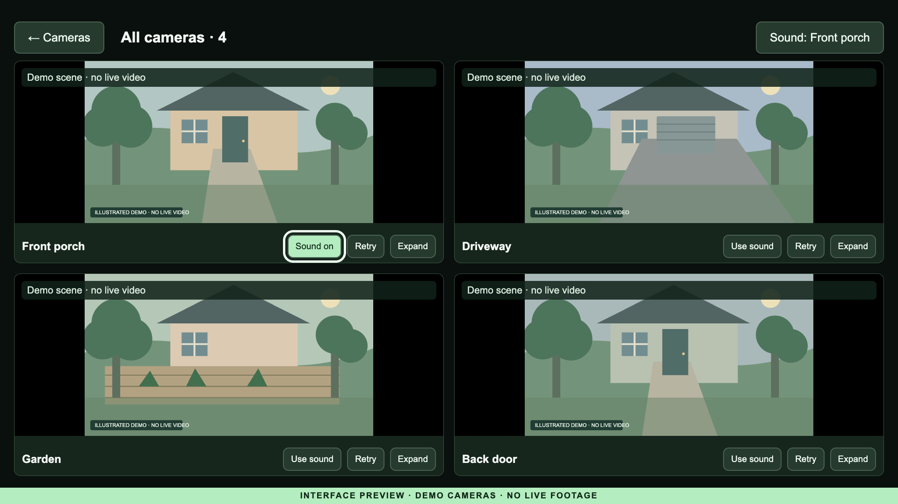
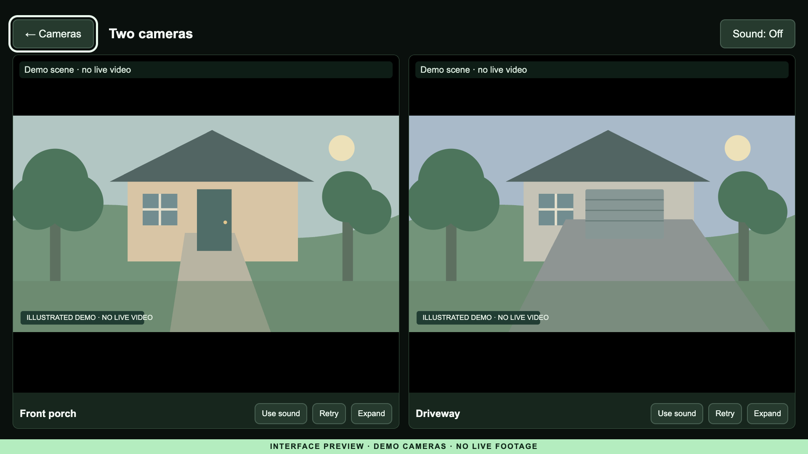
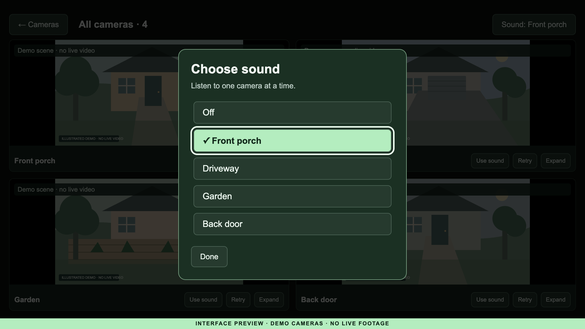
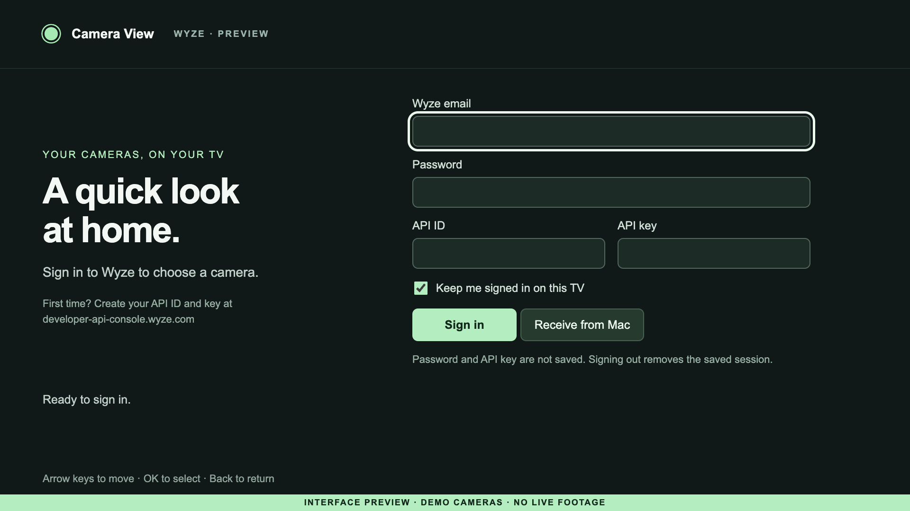

# Wyze cameras on Samsung TV

**Camera View** is an unofficial, standalone Wyze camera viewer for Samsung
Tizen TVs. Watch one camera, choose two, or display all your cameras together.
Choose which camera supplies sound, or turn sound off.

Once installed and signed in, the TV connects to Wyze itself. No Docker,
Raspberry Pi, computer video relay, or phone mirroring is required. A computer
is needed to build/install the app, and optionally to paste credentials during
initial setup. Root access and changes to Samsung Home are **not required**.

## See it on screen

These are browser captures of the actual app interface at its 1920 × 1080 TV
layout, with **illustrated demo scenes in place of camera video**. They are not
photos of a TV or live camera footage. Names and scenes are fictional; no account
or credentials were used. See [how these previews were made](docs/screenshots/README.md).

**All cameras, with one camera supplying sound**



| Two cameras side by side | Choose which camera you hear |
| --- | --- |
|  |  |

<details>
<summary>Sign-in screen</summary>



</details>

## Let GPT-6.1 SOL handle the setup work

You can open a local clone of this repository in **Codex**, select **GPT-6.1 SOL**
if it is available to your account, and ask it to handle the setup work: check
prerequisites, run tests, prepare the encrypted credential handoff, build/sign
the widget and install it on your TV. Run it on a computer that can reach the
TV on your local network. Simply opening the GitHub page does not grant TV access.

For the Codex CLI, start inside the cloned repository with:

```sh
codex --model gpt-6.1-sol
```

Then give it this prompt:

```text
Read this README and docs/SECURITY.md, then help me get Camera View running on
my Samsung TV. Handle the computer-side work end to end: check compatibility
and prerequisites, run the checks, prepare the optional encrypted setup page,
build with my own Samsung certificate, install and launch the app, and help
verify single/two/all-camera video and sound selection. Ask me for my TV model,
Tizen version and network address when needed. Guide me through Developer Mode,
certificate/account sign-in, and physical TV steps that need my input. Keep
credentials out of chat, command arguments, logs and Git; let me enter them in
the private setup form. Do not root the TV or modify Samsung services.
```

You still handle TV menu changes, Samsung sign-in/certificate passwords, Wyze
credentials and verification, and confirming the picture/sound on your TV.
Model availability and tool permissions vary; an agent cannot guarantee support
for an untested TV. See OpenAI's [model selection documentation](https://learn.chatgpt.com/docs/models)
for the exact model name and availability.

## What has actually been tested

- A **2025 Samsung U7900F running Tizen 9**, with **Wyze Cam OG** cameras.
- Account sign-in, encrypted computer-to-TV setup, single/two/all-camera views,
  and selecting a camera's sound or Off were confirmed on the TV.
- Multi-camera capacity depends on your TV, network, cameras and Wyze plan.
  Other models and older Tizen versions have not been verified. The app requires
  Tizen 9 or newer; Developer Mode alone does not establish compatibility.
- The public installer/build tooling is based on the working personal build.
  Installation with another owner's certificate still needs their device test.

This is a community prototype, not a Samsung Store app or an official Wyze
client. Wyze's video endpoint is undocumented and may change.

## What you need

1. A compatible Samsung TV with **Developer Mode enabled**, and a computer on
   the same trusted local network.
2. [Tizen Studio / Samsung TV SDK](https://developer.samsung.com/smarttv/develop/getting-started/setting-up-sdk/installing-tv-sdk.html)
   with Samsung TV and certificate extensions.
3. Your **own Samsung TV author/distributor certificate profile**, including
   your TV's DUID. An emulator/generic Tizen certificate is not sufficient.
4. Python 3.10+ for packaging/installing. Node.js 22+ for tests and the optional
   encrypted setup page. Runtime libraries are already bundled; no npm install
   is required.
5. Your Wyze email/password, API ID and API key. Create the keys in
   [Wyze's developer portal](https://developer-api-console.wyze.com/). Wyze's
   [documented login API](https://support.wyze.com/hc/en-us/articles/16129834216731)
   requires both account credentials and API ID/key, then returns session tokens.
6. Cameras and plan access supported by
   [Wyze Web View](https://support.wyze.com/hc/en-us/articles/4410968629275).
   Cam OG is supported by that service. This viewer does not bypass plan limits.

## 1. Enable Developer Mode and make a certificate

Follow Samsung's [TV device guide](https://developer.samsung.com/smarttv/develop/getting-started/using-sdk/tv-device.html)
and [certificate guide](https://developer.samsung.com/smarttv/develop/getting-started/setting-up-sdk/creating-certificates.html).
Menu labels vary by model. Typically open Apps / App Settings, enter **12345**,
turn Developer Mode on, enter the computer's LAN address, and fully restart the
TV. Record the TV's LAN address too.

In Samsung Certificate Manager, create a **Samsung → TV** profile with your own
author certificate, then a distributor certificate that includes the TV's DUID.
Connect the TV in Device Manager and permit installation if prompted. Keep the
author certificate for future updates. Never commit certificates, passwords,
profiles.xml, DUIDs, or generated widgets to GitHub.

## 2. Build, sign, install and open

Download/clone this repo and open a terminal in its directory. Replace every
uppercase placeholder below with your values. Quote paths containing spaces.

```sh
python3 scripts/package.py --sdk "/PATH/TO/tizen-studio" --profile "YOUR_PROFILE"
python3 scripts/tv.py install --sdk "/PATH/TO/tizen-studio" --host TV_LAN_IP
python3 scripts/tv.py launch --sdk "/PATH/TO/tizen-studio" --host TV_LAN_IP
```

If the CLI cannot find the profile, add
`--profiles "/PATH/TO/profiles.xml"` to the package command. Password entry is
handled by Samsung's tools; do not put passwords in command arguments.

The package/application identity is `WyzeTVView` / `WyzeTVView.Camera`. Keeping
the same identity **and author certificate** allows in-place updates. The
installer reads the SDK upload path from the TV rather than assuming a path.
It does not change Home routing, disable services or install root access.

The commands follow the macOS-tested workflow. Tizen SDK/certificate behavior
on Windows and Linux may differ; those host platforms are not verified here.

## 3. Sign in without typing long keys on the remote

You can type directly on the TV, including with a USB keyboard. For an easier
one-time transfer, prepare the setup session **before building**:

```sh
node scripts/setup.cjs prepare --host COMPUTER_LAN_IP --tv TV_LAN_IP
python3 scripts/package.py --sdk "/PATH/TO/tizen-studio" --profile "YOUR_PROFILE" --setup
python3 scripts/tv.py install --sdk "/PATH/TO/tizen-studio" --host TV_LAN_IP
python3 scripts/tv.py launch --sdk "/PATH/TO/tizen-studio" --host TV_LAN_IP
node scripts/setup.cjs
```

On that same computer, open **http://127.0.0.1:4798/**. Paste the API ID/key;
optionally expand the email/password section. Click **Send to TV**. On the TV,
select **Receive from Mac** (this label also refers to another setup computer),
then **Sign in**. Complete verification on the TV if requested.

The browser form only accepts local computer access. Credentials are sent to
the TV in an authenticated encrypted envelope, held in memory and purged after
receipt. The setup service closes one minute after receipt, or expires after
30 minutes. Generated setup keys/configuration stay under ignored `.local/`;
the package overlay is private. If setup expires or the TV/computer changes IP,
prepare a new session, rebuild with `--setup` and reinstall. Do not publish that
personalized widget. Normal viewing continues when the computer is off.

The initial Samsung developer installation uses Samsung's developer transport;
use a trusted LAN and do not forward its ports or the setup port to the internet.

## 4. Watch and control

- **Single camera:** select a camera tile. Back returns to the camera list.
- **Two cameras:** select Two cameras, choose exactly two tiles, then Watch selected.
- **All cameras:** select All cameras to refresh availability and show only online
  cameras. Feeds that fail to connect or stop working disappear, and the remaining
  tiles resize. If none are available, the app returns to the camera list with a
  message. Use Refresh or All cameras again to check for newly available cameras.
  Single-camera and Two cameras views retain their retry/expand controls.
- **Sound:** in multi-camera view, use Sound at the top right and choose a camera
  by name or Off. Only one source is audible. Use sound on a tile is a shortcut.
- **Remote:** arrows move focus, OK selects, Back closes a menu/view. Returning
  to Home or another app closes active camera connections.
- **Home shortcut:** pin Camera View through Samsung's Apps menu. With a custom
  launcher such as CleanFrame, use its installed-app list / Apps on Home editor.
  The viewer does not remap your physical Home button.

## Privacy and sign-out

No analytics, third-party diagnostics collector, account details, camera images,
device addresses, certificates or setup-session keys are included in this repo.
The app sends account requests to Wyze and uses Wyze/AWS signaling and ICE/TURN
services for video. This is **not** an offline/cloud-free viewer.

Password, API key/ID and MFA details are held in memory for sign-in, not saved
by the app. **Keep me signed in** saves access/refresh tokens in this app's TV
storage; that storage is **not encrypted by this app**. Anyone with sufficient
TV access may be able to read it. Uncheck the option for session-only access.
**Sign out** removes the saved session. Wyze documents access/refresh token
lifetimes and key revocation in its developer API guide.

Read [security and data flow](docs/SECURITY.md) before contributing or reporting
an issue. Do not attach account responses, HAR captures or unredacted screenshots.

## Troubleshooting

- **Connection refused / developer commands hang:** confirm the addresses,
  Developer Mode host setting, same-network access and the TV is fully on.
  Fully restart the TV, reconnect in Device Manager, and retry.
- **Certificate/install failure:** check Samsung TV certificate type, target
  DUID, installation permission, and matching original author certificate.
- **Wrong credentials / rate limit:** confirm API ID vs API key. Don't keep
  retrying login; Wyze rate-limits it. The app uses refresh tokens afterward.
- **Verification:** TOTP/SMS paths are implemented but not independently verified
  across accounts. Email-only MFA is not currently implemented.
- **Video setup failure:** the app restricts H.264 negotiation and corrects a
  sendrecv response to a receive-only offer. This fixed Cam OG on the tested TV;
  other devices/firmware may still fail. Do not assume every WebRTC TV works.
- **A camera is missing from All cameras:** offline or failed feeds are excluded.
  Open it individually from the camera list to see its error, or choose All
  cameras again to refresh availability. TV decoder/memory and plan limits can
  constrain simultaneous streams; try a single camera, then two.
- **No audio:** choose a source, confirm the camera has audio enabled, and check
  TV volume. Selecting a source cannot create audio on a silent camera.

## Development

```sh
node --test tests/*.test.cjs
python3 scripts/check_public.py
python3 scripts/package.py --unsigned
python3 -m http.server 4797 --bind 127.0.0.1 --directory app
```

Open http://127.0.0.1:4797/ for a UI preview. Desktop-browser CORS and media support
can differ from a packaged TV app. Tests mock account/media responses; passing
tests is not a substitute for an actual TV check. No credentials are needed for
tests or unsigned packaging. There is deliberately no pre-signed universal
download; sign your own build with a certificate authorized for your TV.

MIT license. See [third-party notices](THIRD_PARTY_NOTICES.md) for upstream credit
and bundled dependency licenses. Samsung and Wyze do not endorse this project.

## How this started / Samsung TV credits

This project grew out of exploring how to make a Samsung TV more useful and
less cluttered. These were the starting points shared during that exploration:

- [Nathan Clark's original X post](https://x.com/nathanclark/status/2112416625496576455)
  started the Samsung TV investigation.
- [The follow-up X post from @log4j](https://x.com/log4j/status/2113028209612644795)
  was shared during the Samsung privacy and unwanted-services discussion.
- [chris-ritsen/samsung-tv-root](https://github.com/chris-ritsen/samsung-tv-root)
  supplied the community research and tooling behind the separate Samsung TV
  customization work that led here. Thanks to its author and contributors.

Those links are background and credit. **Camera View itself only needs the
developer installation described above; rooting and debloating are not part of
this app's installation.** Wyze API and dependency credits are listed separately
in [third-party notices](THIRD_PARTY_NOTICES.md).
